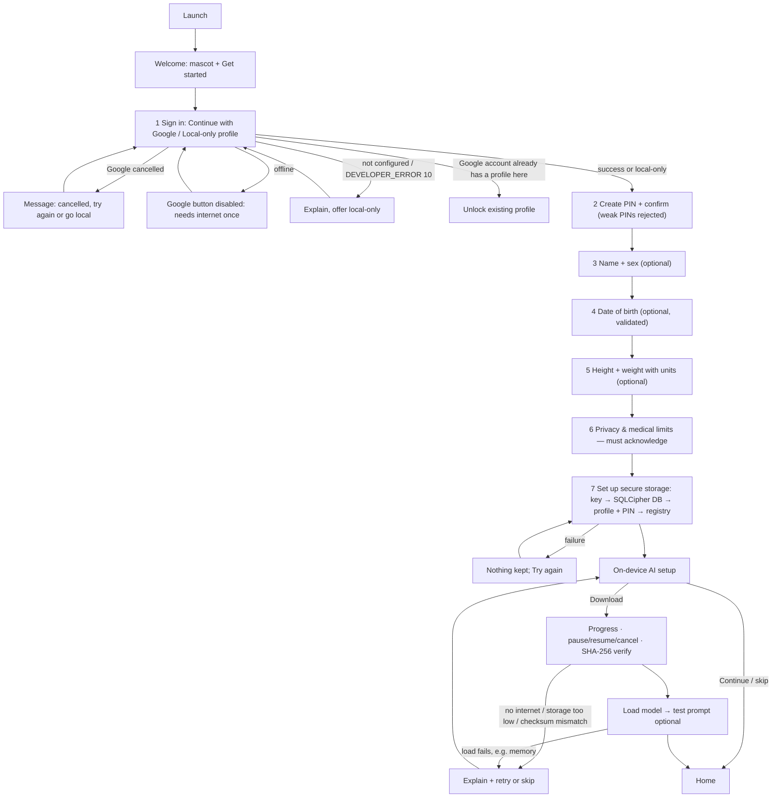
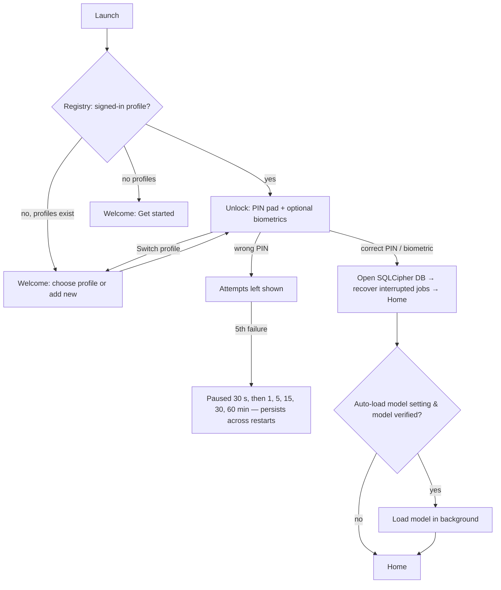
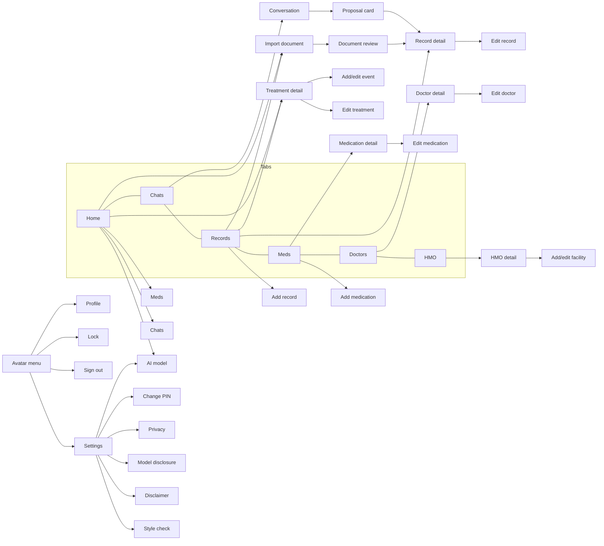

# Doc Pawi — Application Flow

> **Document role:** the user journeys, screens, states, and decisions.
> Related: [PRD](PRD.md) · [Design Brief](DESIGN_BRIEF.md) · [Local AI Architecture](LOCAL_AI_ARCHITECTURE.md) · [Panelist Testing Guide](PANELIST_TESTING_GUIDE.md)

Routes live in [`src/app`](../src/app). The root layout exposes different route groups depending on the session state (`Stack.Protected`):

| Session state | Available routes |
|---|---|
| `signed_out` | `welcome`, `onboarding/*` |
| `locked` | `unlock` |
| `unlocked` | `(app)/*` (tabs and detail screens) |

When the state changes (unlock, idle lock, sign-out), Expo Router moves to the first available route automatically.

## 1. First launch

Notes
- Nothing is written to disk until step 7; abandoning onboarding leaves no partial profile.
- Google sign-in is only needed once per new profile; returning users never need it.
- The model step can be skipped; AI features then show a "Set up AI model" prompt.

## 2. Returning user

- Idle lock: returning from the background after the timeout (default 5 min), or no touches in the foreground for the timeout (paused while the model is working), locks the vault: generation stops, the KV cache is cleared, the DB is closed, and the unlock screen appears.
- If the model is missing or fails to load, everything except AI chat/analysis keeps working; the Chats screen shows the model state and a link to setup.
- Forgotten PIN: cannot be recovered or bypassed (by design). The only reset is clearing the app's storage in Android settings, which erases all local profiles.

## 3. Main navigation

All detail and form screens are pushed onto the `(app)` stack above the tabs (native header with back button). Confirmation dialogs are modals.

## 4. AI conversation
See the sequence diagram in [LOCAL_AI_ARCHITECTURE.md §3](LOCAL_AI_ARCHITECTURE.md#3-conversation-flow). States the user can see:

| Situation | What the user sees |
|---|---|
| Model not installed | Banner with "Set up AI model"; Send disabled |
| Model installed, not loaded | First message loads it automatically ("Reading your local records and thinking on-device…") |
| Chats or a conversation opened | The model reads its fixed instructions in the background (30–50 s on the test phone, no visible state); a message sent meanwhile waits for it and then starts sooner |
| Model fails to load | Error banner with link to the model screen; the assistant message is saved with status *error* and an honest reason |
| Another AI job running | Send disabled; input placeholder says a document is being analyzed |
| Generating | Streaming text; Send becomes a red Stop button |
| Stopped | Partial text kept, labelled "Stopped — response incomplete" |
| No matching records | The answer says it is not recorded; "No personal records were needed" or the list of sources used is shown |
| Model proposes a change | Dashed "AI suggestion — not saved" card: Confirm & save / Edit / Reject; a note when the suggested facility was not in the user's message |
| Answer finished | Sources used, "AI-generated on this phone by …", and the speed line (or "Prompt was already in the model cache") |
| Invalid model output | "An invalid AI suggestion was discarded (reason)"; nothing saved |
| Emergency words | Red emergency banner with "Call 911" under the user's message |
| Dose-change question | Fixed safety note under the answer |

## 5. Document processing
See [LOCAL_AI_ARCHITECTURE.md §5](LOCAL_AI_ARCHITECTURE.md#5-document-flow). Screen states: *Reading text…* (OCR, seconds) → *Analyzing with local AI…* (elapsed time shown, Stop available, user may leave the screen) → *Ready for review* (editable fields, Found/Verify labels; a warning under the summary when it calls a result abnormal that the document does not flag, or normal when it does — the summary label then reads "check before saving") → *Saved to records* or *Suggestion rejected*. Failures (no text found, PDF password-protected, model output invalid, interrupted) show a reason and a Retry or "Add record manually" path.

## 6. Medication and treatment flows

| Journey | Steps | Result |
|---|---|---|
| Add a medication | Meds → Add medication → name, strength, form, instructions, optional prescriber/dates → daily dose times + dose labels → Save | Medication + schedules saved; reminders reconciled |
| Confirm a schedule | Medication detail shows dose times; Edit to change | Unchanged times keep their history links |
| Record Taken / Skipped | Home or Meds → Today → Taken or Skipped on a dose row | One `dose_event` for that slot; badge shows the status; Undo available |
| Archive | Medication detail → Archive (confirm) | Status archived, reminders cancelled, history kept |
| Delete permanently | Medication detail → Delete permanently → type DELETE | Medication, schedules, and history deleted |
| Add a vaccination | Records → Vaccinations → Add vaccine series or dose → series (kind Vaccination) → Add event (dose, completed/scheduled, date) | Series + dose event in the timeline |
| Review an ongoing treatment | Home → Ongoing treatments → treatment → timeline; Mark completed on a scheduled event | Completed date recorded (today or the scheduled date if past) |
| Confirm an AI-proposed event | Chat: "I got my 2nd hepatitis B dose today" → proposal card → optionally pick the existing series → Confirm | Event added to the user's existing series or a new series is created (never to a synthetic demo series) |
| Remove demo data | Settings → Remove demo data → confirm | Demo rows deleted; anything the user added to a demo series is moved to a series of their own first |

Reminders: Android 13+ asks for notification permission (with an explanation in Meds/Settings). Denial is handled: a banner explains and offers app settings; doses can still be recorded manually. Notifications never mark a dose as taken.

## 7. Offline and error flows

| Condition | What the user sees | Still works |
|---|---|---|
| Phone offline | Google sign-in button disabled with an explanation; model download disabled with "You are offline" | Unlock, chat (installed model), OCR, records, meds, doctors, HMO, reminders |
| Model missing | Chats/document review show "Set up AI model" | Everything except AI answers and AI document analysis (OCR still works) |
| Model fails to load | Error with likely cause (memory) and suggestion (close apps / smaller model) | Same as above |
| Download fails | "Model download failed: … check your connection"; partial file removed | Retry later |
| Not enough storage | Download button disabled + required vs available space | — |
| OCR finds no text | Tips for a better photo; Retry or add manually | Document stays stored encrypted |
| Database cannot be opened | Unlock shows "The health database could not be decrypted…" | Other profiles |
| Notification permission denied | Banner in Meds + Settings with "Open app settings" | Manual dose tracking |
| Camera permission denied | Banner with "Open app settings"; gallery and file import still available | Other import sources |
| Map hand-off without a maps app | Button shows "No maps app available" | Address stays visible/selectable |
