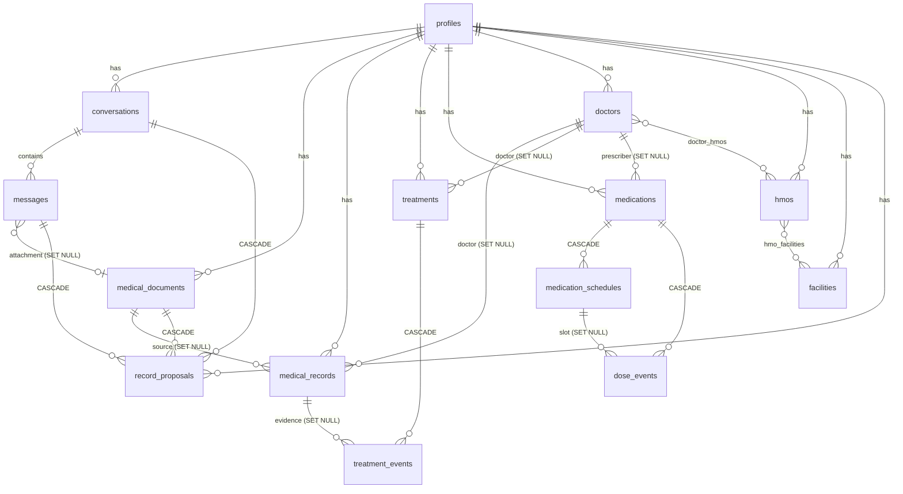

# Doc Pawi — Database Schema

> **Document role:** the actual persistent data model. Source of truth in code: [`src/lib/db/migrations.ts`](../src/lib/db/migrations.ts) (migration v1) and [`src/lib/db/models.ts`](../src/lib/db/models.ts). This document must change whenever a migration is added.
> Related: [Privacy](PRIVACY.md) · [Technical Requirements](TECHNICAL_REQUIREMENTS.md) · [Testing](TESTING.md)

There is **no server database**. Each local profile has its own encrypted SQLite database on the phone.

## 1. Storage layout

| Item | Location (app-private) | Protection |
|---|---|---|
| Profile database | `files/SQLite/docpawi-<profileId>.db` (+ `-wal`, `-shm`) | SQLCipher 4 (AES-256), random 256-bit raw key |
| Database key | expo-secure-store key `docpawi.dbkey.<profileId>` | Encrypted with an Android Keystore AES-GCM key |
| PIN verifier | `docpawi.pin.<profileId>` (PBKDF2-SHA256, 120,000 iterations, 128-bit salt) | SecureStore |
| PIN throttle state | `docpawi.throttle.<profileId>` | SecureStore |
| Biometric preference | `docpawi.bio.<profileId>` | SecureStore |
| Profile registry | `docpawi.registry.v1` (id, display name, email, auth provider/subject, signed-in profile) | SecureStore |
| Documents | `files/vault/<profileId>/<documentId>.dpv` | AES-256-GCM, non-exportable Keystore key `docpawi_vault_<profileId>` |
| Doctor photos | `files/doctor-photos/<profileId>/` | App-private storage (not health records) |
| AI models | `files/models/*.gguf` + `manifest.json` | App-private; shared by profiles; no personal data |

Every connection runs `PRAGMA key = "x'<64 hex>'"` first, then `PRAGMA journal_mode = WAL; PRAGMA foreign_keys = ON`. Android Auto Backup is disabled (`allowBackup: false`).

## 2. Entity-relationship diagram

## 3. Conventions

- Primary keys are UUID v4 strings (`TEXT`).
- `created_at` / `updated_at` / `event_at` are UTC ISO-8601 timestamps.
- Calendar dates (`event_date`, `birth_date`, `scheduled_date`, …) are local `YYYY-MM-DD` strings checked with `GLOB` constraints; Zod additionally rejects impossible dates (e.g. 2026-02-30) and future dates where they make no sense.
- Dose slots are local wall-clock `YYYY-MM-DDTHH:MM` (`scheduled_for`) with the IANA time zone recorded per event, because medication schedules follow local time.
- `source_type` records provenance: `manual`, `document` (confirmed document extraction), `ai_chat` (confirmed chat suggestion), `demo` (synthetic evaluation data).
- Enumerated columns use `CHECK (… IN (…))` generated from the same TypeScript constant arrays used by Zod.
- JSON columns are checked with `json_valid()`.

## 4. Tables

### `schema_migrations`
Purpose: applied migration versions. Columns: `version INTEGER PK`, `name TEXT`, `applied_at TEXT`. Opening a database whose version is newer than the app is refused (downgrade protection).

### `profiles`
One row per database (the profile that owns it).

| Column | Type | Null | Notes |
|---|---|---|---|
| id | TEXT PK | no | Same id as the registry entry |
| auth_provider | TEXT | no | `google` or `local` |
| auth_subject | TEXT | yes | Google account id; `UNIQUE(auth_provider, auth_subject)` |
| display_name | TEXT | no | 1–80 characters |
| email | TEXT | yes | From Google |
| sex | TEXT | yes | `female`, `male`, `intersex`, `prefer_not_to_say` |
| birth_date | TEXT | yes | Not in the future |
| height_value / height_unit | REAL / TEXT | yes | > 0; `cm` or `in`; plausible ranges enforced by Zod |
| weight_value / weight_unit | REAL / TEXT | yes | > 0; `kg` or `lb` |
| created_at / updated_at | TEXT | no | |

### `conversations`
`id`, `profile_id` → profiles (CASCADE), `title` (derived from the first message), `created_at`, `updated_at`. Index `(profile_id, updated_at DESC)`. Deleting a conversation cascades to its messages and pending chat proposals; confirmed records remain.

### `messages`
| Column | Type | Notes |
|---|---|---|
| id | TEXT PK | |
| conversation_id | TEXT → conversations CASCADE | |
| role | TEXT | `user` / `assistant` |
| content | TEXT | Final text (partial text if stopped) |
| status | TEXT | `complete`, `generating`, `stopped`, `error`; `generating` rows left by a crash are marked `stopped` at next unlock |
| attachment_document_id | TEXT → medical_documents SET NULL | Optional |
| model_metadata | TEXT JSON | Model id/file, engine, timings (tokens/s), stop reason, sources used, tool-call validation results, safety flags |
| created_at | TEXT | Index `(conversation_id, created_at)` |

### `medical_documents`
| Column | Type | Notes |
|---|---|---|
| id, profile_id | TEXT | profile CASCADE |
| display_name | TEXT | |
| mime_type | TEXT | `image/jpeg`, `image/png`, `image/webp`, `application/pdf` |
| private_file_path | TEXT UNIQUE | Encrypted vault file |
| file_size, sha256 | INTEGER, TEXT | Of the plaintext, computed while encrypting |
| encryption | TEXT | `aes-256-gcm` |
| imported_at | TEXT | |
| processing_status | TEXT | `imported` → `extracting_text` → `text_extracted` → `analyzing` → `ready_for_review` → `confirmed` / `rejected`; or `failed` (interrupted runs are reset to `failed` with a retry message) |
| ocr_engine, page_count | TEXT, INTEGER | |
| extracted_text | TEXT | OCR output (inside the encrypted DB) |
| summary | TEXT | AI-generated summary |
| error_message | TEXT | User-facing error |
| source_type | TEXT | `user` or `demo` (bundled synthetic sample) |

Deleting a document: the row is deleted in a transaction (records keep their data with `document_id` set to NULL; pending proposals cascade), then the encrypted file is deleted.

### `medical_records`
| Column | Type | Notes |
|---|---|---|
| id, profile_id | TEXT | profile CASCADE |
| category | TEXT | `visit`, `diagnosis`, `lab_result`, `procedure`, `allergy`, `imaging`, `prescription`, `vaccination`, `note`, `other` |
| title | TEXT | 1–160 |
| event_date | TEXT | Optional, not in the future |
| source_type | TEXT | Provenance (never changed by edits) |
| summary | TEXT | |
| structured_data | TEXT JSON | e.g. `{ lab_results: [{test, value, unit, reference_range, flag}], medications, vaccinations, diagnoses, clinician, document_type }` |
| document_id | TEXT → medical_documents SET NULL | |
| doctor_id | TEXT → doctors SET NULL | |
| facility | TEXT | |
Indexes: `(profile_id, event_date DESC)`, `(profile_id, category)`, `(document_id)`.

### `treatments` and `treatment_events`
`treatments`: treatment episodes and vaccine series — `title`, `kind` (`vaccination`, `medication_course`, `therapy`, `procedure`, `monitoring`, `other`), `status` (`planned`, `ongoing`, `completed`, `stopped`), `start_date`, `end_date`, `facility`, `doctor_id` (SET NULL), `notes`, `source_type`. Index `(profile_id, status)`.

`treatment_events`: doses, sessions, visits — `treatment_id` (CASCADE), `profile_id`, `title`, `event_type` (`dose`, `visit`, `test`, `procedure`, `session`, `other`), `status` (`scheduled`, `completed`, `missed`, `cancelled`), `scheduled_date`, `completed_date`, `facility`, `notes`, `medical_record_id` (SET NULL), `source_type`. Zod rules: scheduled events need a date; only completed events have a completed date, which cannot be in the future. Indexes: `(treatment_id)`, `(profile_id, status, scheduled_date)`.

**Vaccination history** = treatments of kind `vaccination` with their dose events (plus any `medical_records` with category `vaccination`, e.g. from a vaccination card).

### `medications`, `medication_schedules`, `dose_events`
`medications`: definitions — `name`, `strength`, `form`, `instructions`, `prescriber_doctor_id` (SET NULL), `start_date`, `end_date`, `status` (`active`/`archived`), `archived_at` (CHECK: set iff archived), `source_type`. Index `(profile_id, status)`.

`medication_schedules`: daily dose times — `medication_id` (CASCADE), `time_of_day` (`HH:MM` < 24:00), `dose_label`, `reminder_enabled`, `notification_id` (OS notification), `UNIQUE(medication_id, time_of_day)`. Editing a medication keeps schedule rows whose time is unchanged so history keeps its `schedule_id`.

`dose_events`: actual history, separate from definitions — `medication_id` (CASCADE), `schedule_id` (SET NULL), `profile_id`, `scheduled_for` (local slot), `event_at` (UTC when taken/skipped), `timezone`, `status` (`taken` / `skipped`), `note`, `UNIQUE(medication_id, scheduled_for)` so a slot has at most one event; recording again replaces the status (correction), Undo deletes it. "Due" and "upcoming" are computed, never stored. Archiving keeps history; permanent deletion removes it (requires typing DELETE).

### `doctors`, `hmos`, `facilities`, `doctor_hmos`, `hmo_facilities`
`doctors`: `name`, `specialty`, `organization`, `address`, `phones` (JSON array), `emails` (JSON array), `photo_path`, `notes`, `source_type`. Index `(profile_id, name)`.

`hmos`: `provider_name`, `plan_name`, `member_id`, `valid_until`, `coverage_notes`, `hotline`, `source_type`.

`facilities`: `name`, `facility_type` (`hospital`, `clinic`, `laboratory`, `diagnostic_center`, `pharmacy`, `other`), `address`, `phone`, `notes`, `source_type`.

`doctor_hmos (doctor_id, hmo_id)` and `hmo_facilities (hmo_id, facility_id, note)`: user-reported links (composite PKs, CASCADE on both sides). The UI always labels them "user-reported / not verified".

### `record_proposals`
AI suggestions awaiting review; kept separate so a suggestion never appears in Records before confirmation.

| Column | Notes |
|---|---|
| origin | `chat` or `document` |
| proposal_type | `medical_record` or `treatment_event` |
| conversation_id / message_id / document_id | Context (CASCADE) |
| payload | JSON (validated with Zod on read and again at confirm) |
| status | `pending`, `confirmed`, `rejected`; CHECK: `resolved_at` set iff not pending |
| result_entity_type / result_entity_id | The record or event created on confirm |

### `app_settings`
Per-profile preferences as JSON values: `idleLockMinutes`, `remindersEnabled`, `showMedicationNamesInNotifications`, `biometricUnlock`, `autoLoadModel`.

## 5. Transaction boundaries

| Operation | Transaction contents |
|---|---|
| Confirm a proposal | Insert record **or** (find/create treatment + insert event) + mark proposal confirmed (guarded `WHERE status = 'pending'`) + update document status |
| Reject a proposal | Mark rejected + update document status if all its proposals are rejected |
| Save AI response | Update assistant message + insert validated proposals |
| Document analysis | Delete stale pending proposals + insert new proposal + save summary/status |
| Create/update medication | Medication row + schedule rows (diffed) |
| Archive medication | Status + clear notification ids |
| Create/update doctor | Doctor row + HMO links |
| Create facility from an HMO | Facility + link |
| Delete document | Row deletion (cascades/SET NULL) — file deleted after commit |
| Delete all conversations | Single `DELETE` (cascades) |
| Load/remove demo data | All demo rows in one transaction |
| Migrations | Each migration + its `schema_migrations` row |

Writes are serialized by an in-app lock (`createDb`) so transactions never interleave on the single connection.

## 6. Sensitive data inventory

| Data | Where |
|---|---|
| Health records, medications, dose history, treatments, vaccinations, doctors, HMO member IDs, conversations, OCR text, AI summaries | Encrypted SQLCipher database |
| Original documents | Encrypted vault files |
| Name, email, Google subject, PIN verifier, keys | SecureStore (Keystore-encrypted) |
| Doctor photos | App-private files (unencrypted; not health records) |
| Model files | App-private files (public model weights) |
