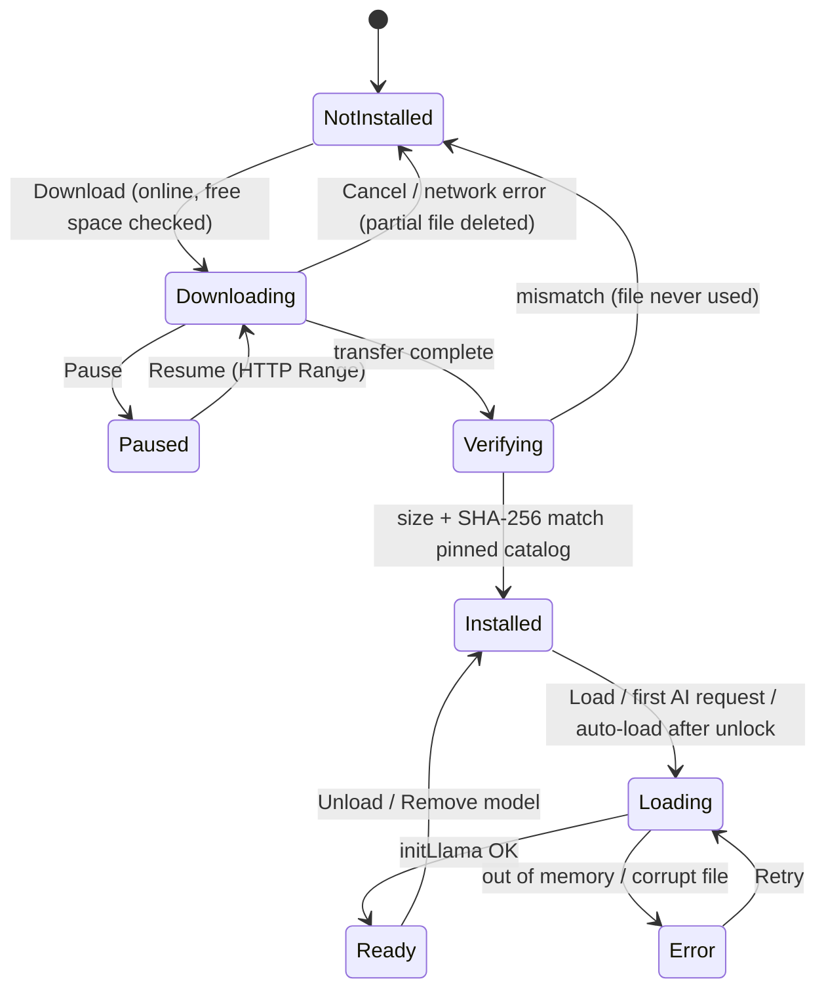
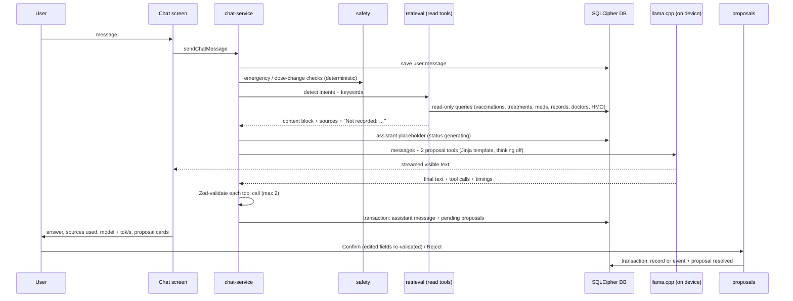
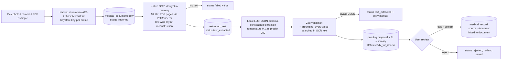

# Doc Pawi — Local AI Architecture

> **Document role:** how AI runs on the phone, what data flows where, and which controls keep it safe.
> Related: [Model Disclosure](MODEL_DISCLOSURE.md) · [Technical Requirements](TECHNICAL_REQUIREMENTS.md) · [Privacy](PRIVACY.md) · [App Flow](APP_FLOW.md)

## 1. Components

| Component | Implementation | Runs where | Network? |
|---|---|---|---|
| Language model | Qwen3 1.7B Q4_K_M (default) or Qwen3 0.6B Q8_0, GGUF | Phone CPU | No (after the one-time download) |
| Inference runtime | llama.cpp b10256 via `llama.rn` 0.12.9 (`src/lib/ai/llama-engine.ts`) | Phone CPU, JSI native threads | No |
| Model manager | `src/stores/model-store.ts` (download, SHA-256 verify, load/unload, test prompt) | Phone | Download only |
| Medical-context retrieval | `src/lib/ai/retrieval.ts` (intent + keyword router over repositories) | Phone | No |
| Bounded agent tools | `src/lib/ai/agent-tools.ts` (2 proposal tools, Zod-validated) | Phone | No |
| OCR | ML Kit Text Recognition v2, bundled Latin model (`modules/doc-pawi-native`) | Phone | No* |
| Document extraction | Grammar-constrained JSON + Zod + grounding (`src/lib/ai/extraction.ts`) | Phone | No |
| Safety layer | `src/lib/ai/safety.ts`, system prompt rules | Phone | No |

\* ML Kit may send anonymous usage metrics to Google when online; images and text are processed on-device and are not sent ([PRIVACY.md](PRIVACY.md)).

**OpenMed:** investigated and **not integrated** in this build (16 KB page-size incompatibility of its DJL tokenizer native library, minSdk 26, failing JitPack release build, downloader bug, English-only single-entity NER models of ~70 MB each, and no upstream on-device testing). See [TECHNICAL_REQUIREMENTS.md §4](TECHNICAL_REQUIREMENTS.md#4-compatibility-decisions-and-trade-offs). No OpenMed functionality is claimed.

## 2. Model lifecycle

- Files live in app-private storage: `files/models/<file>.gguf` plus `manifest.json` (verified checksums, selected model). They are shared by all local profiles and contain no personal data.
- Context parameters: `n_ctx 4096`, `n_batch/n_ubatch 512`, `n_gpu_layers 0` (CPU), `use_mmap true`, `use_mlock false`, `ctx_shift false`, f16 KV cache. Threads use llama.rn's default (up to 4, pinned to the fastest cores).
- Only one inference job runs at a time (`activeJob`: chat, document, or test). The UI blocks a second job with an explanation.
- Locking or signing out stops generation and clears the KV cache so no conversation tokens remain in the context; model weights stay loaded for a quick return.

## 3. Conversation flow

### Prompt structure
- **System prompt (static):** role, "use only the Local records for user-specific facts; say it is not recorded otherwise", no diagnosis/prescribing/dose changes, emergency instruction (911 Philippines), when to call tools, short answers. Static content lets llama.cpp reuse its KV cache across turns.
- **Latest user turn:** today's date, the retrieved local records (≤ 2,600 characters, member IDs masked to the last 4 characters), explicit "Not recorded in Doc Pawi: …" lines for requested topics with no data, then the question.
- **History:** last 6 messages (≤ 2,400 characters), earlier record context is not repeated.
- **Sampling:** temperature 0.7, top-k 20, top-p 0.8, min-p 0, presence penalty 0.5 (0 for JSON), `n_predict` 400 for chat. All parameters are passed on every call because llama.rn keeps omitted values from the previous call.

### Why retrieval runs before inference
The read tools (search records, vaccinations, medications, treatments, doctors, HMO) are executed by a deterministic router instead of letting the model request them. On the tested mid-range phone, each extra model round-trip costs tens of seconds, and a 1.7B model is unreliable at multi-step tool use. The trade-off is that retrieval is keyword/intent based (no semantic search).

## 4. Bounded agent tools

| Tool | Purpose | Validation | Effect |
|---|---|---|---|
| `propose_medical_record` | Visit, diagnosis, lab/test result, procedure, allergy, imaging, note | Zod: enum category, title ≤ 160, real `YYYY-MM-DD` date, unknown fields stripped; future dates removed with a warning | Pending proposal only |
| `propose_treatment_event` | Vaccine dose, therapy session, treatment visit (completed or scheduled) | Zod: treatment type enum, status `completed`/`scheduled`, date direction checked against status | Pending proposal only |

The model **cannot** read or write the database directly, access files, run code, or reach the network. Unknown tool names and malformed arguments are discarded and the reason is stored in the message metadata (shown as "An invalid AI suggestion was discarded"). At confirm time the (possibly edited) payload is validated again with the same Zod schemas as manual forms, inside one transaction.

## 5. Document flow

- Plaintext never persists: the document picker passes a `content://` URI that the native module encrypts directly; camera/gallery cache copies are deleted after encryption; PDFs are decrypted to a temporary cache file only while `PdfRenderer` reads them; image previews are decrypted to the cache and deleted when the preview closes.
- Up to 5 PDF pages are processed; the rest are noted as skipped.
- **Grounding:** each extracted value (date, facility, clinician, test names, values, units, reference ranges, medication names/strengths, vaccine names/dates) is normalized and searched in the OCR text. Values not found are shown as **Verify** on the review screen. Future or invalid dates are cleared.

## 6. Safety controls

| Risk | Control |
|---|---|
| Emergency symptoms | Deterministic red-flag patterns (English + common Tagalog phrases) show an emergency banner with a "Call 911" button on the user's message, independent of the model; the system prompt repeats the instruction. |
| Dose-change questions | Deterministic detector adds a fixed note ("cannot advise changing … ask your prescriber or pharmacist") under the answer; system prompt forbids dose advice; medication forms say Doc Pawi never changes doses. |
| Fabricated history | Records come only from retrieval; explicit "Not recorded" lines; system rule to say it is not recorded; sources shown under each answer. |
| Invented records | Proposals only; Zod validation; explicit confirmation; provenance (`ai_chat`, `document`) stored on every saved row. |
| OCR/LLM extraction errors | Grounding check + "Verify" labels; editable review; original text available. |
| Overconfident presentation | Every AI message shows "AI-generated on this phone by <model> · Not medical advice"; summaries are labelled AI-generated. |
| Prompt injection inside documents | Extraction output is constrained to a JSON schema with no tool access; it can only produce a proposal the user reviews. |

## 7. Network boundaries

| Operation | Network | Data sent |
|---|---|---|
| Chat, retrieval, proposals, document OCR + extraction, reminders, all records | **None** | — |
| Model download | Hugging Face (`huggingface.co` → CDN) | HTTP GET for a public file |
| Google sign-in (optional) | Google | Standard OAuth sign-in |
| Maps / call / email buttons | Other apps | The address, phone number, or email the user tapped |
| ML Kit metrics | Google (when online) | Anonymous API usage/performance metrics (no images or text) |

## 8. Measured performance

Measured on the physical test device and recorded in [TESTING.md](TESTING.md#4-on-device-results) and [MODEL_DISCLOSURE.md](MODEL_DISCLOSURE.md#measured-performance). No GPU/NPU acceleration is claimed.
